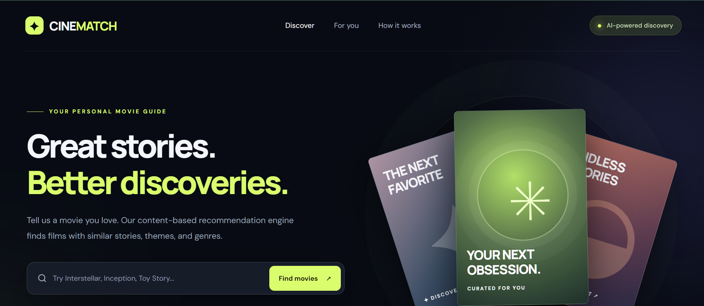
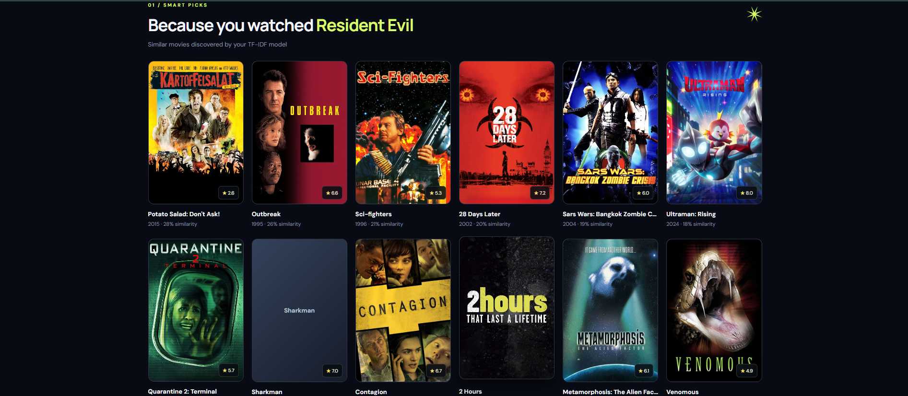

<div align="center">

# 🎬 CineMatch — Movie Recommendation System

### Discover movies you'll love with content-based machine learning

A responsive movie discovery website combining **TF-IDF content similarity** with **The Movie Database (TMDB) API** for movie posters, search, details, and genre-based recommendations.

[](https://movie-recommendation-system-ubjs.onrender.com/)
[](https://www.python.org/)
[](https://fastapi.tiangolo.com/)
[](#license)

**[🌐 Live Website](https://movie-recommendation-system-ubjs.onrender.com/)** · **[💻 Source Code](https://github.com/Sj3604/Movie_Recommendation_System)** · **[📚 API Docs](https://movie-recommendation-system-ubjs.onrender.com/docs)**

</div>

---

## Overview

**CineMatch** is a full-stack movie recommendation web app. It uses a precomputed **TF-IDF feature matrix** to identify content-similar movies in a local movie dataset, while the **TMDB API** provides fresh movie metadata, posters, movie search, and genre-based suggestions.

The interface is built using HTML, CSS, and vanilla JavaScript, and is served by a **FastAPI** backend. The application is deployed as one Render Web Service.

## Features

- **Content-based recommendations:** Suggests movies with similar TF-IDF representations to a selected movie.
- **Genre-based discovery:** Recommends popular movies from the first genre associated with the selected movie on TMDB.
- **Live movie search:** Provides title suggestions while typing, using TMDB search results.
- **Movie details:** Displays title, poster, release year, overview, and genres.
- **Browse by category:** Explore trending, popular, top-rated, upcoming, and now-playing movies.
- **Similarity scores:** Displays similarity percentages for content-based recommendations.
- **Responsive UI:** A dark-themed interface designed for desktop and smaller screens.
- **API docs and health checks:** Interactive Swagger documentation and `/health` endpoint.

## Screenshots

### Homepage — Discover CineMatch



The homepage introduces the movie discovery experience, with a search bar for titles such as *Interstellar*, *Inception*, and *Toy Story*.

### Content-Based Recommendations — TF-IDF Smart Picks



A recommendation example for **Resident Evil**, displaying related movies, posters, ratings, and similarity percentages generated from the local TF-IDF model.

## How the Recommendation Engine Works

### 1. TF-IDF content-based recommendations

At startup, the application loads four previously generated model artifacts:

| File | Purpose |
| --- | --- |
| `df.pkl` | Movie dataset including titles |
| `indices.pkl` | Mapping between movie titles and dataset row indices |
| `tfidf.pkl` | Saved TF-IDF vectorizer |
| `tfidf_matrix.pkl` | Precomputed TF-IDF feature matrix |

When a user selects a movie title:

1. The backend looks up that title in the local dataset.
2. It retrieves the corresponding row from `tfidf_matrix.pkl`.
3. It calculates similarity scores using a sparse matrix–vector dot product.
4. It ranks the other movies by score and excludes the selected movie.
5. It optionally uses TMDB title search to attach posters and ratings to the recommendations.

**Implementation note:** The backend uses the dot product directly; this is equivalent to cosine similarity **when the TF-IDF vectors are L2-normalized**, as is typical with scikit-learn's default TF-IDF settings. The saved vectorizer isn't refitted at runtime.

### 2. Genre-based recommendations

The application retrieves movie details from TMDB, selects the **first** genre returned for that movie, and uses TMDB's discover endpoint to retrieve popular movies in the same genre. It excludes the selected movie from the returned recommendations.

### 3. Fallback behavior

Movies available on TMDB but absent from the local dataset may still receive **genre-based suggestions**. Content-based TF-IDF recommendations require a matching movie title in the local dataset.

## Tech Stack

| Layer | Technologies |
| --- | --- |
| Frontend | HTML5, CSS3, JavaScript (vanilla) |
| Backend | Python, FastAPI, Uvicorn |
| Recommendation model | TF-IDF, NumPy, SciPy, scikit-learn, Pandas |
| Movie metadata | The Movie Database (TMDB) API |
| HTTP requests | HTTPX (backend), Fetch API (frontend) |
| Dependency management | `uv`, `pyproject.toml`, `uv.lock` |
| Hosting | Render Web Service |
| Version control | Git and GitHub |

## Project Structure

```text
Movie_Recommendation_System/
├── main.py                   # FastAPI application and recommendation endpoints
├── screenshots/
│   ├── homepage.png          # Homepage screenshot
│   └── recommendations.png   # TF-IDF recommendation screenshot
├── static/
│   ├── index.html            # Website UI
│   ├── style.css             # Responsive styling
│   └── script.js             # Frontend API integration and interactions
├── df.pkl                    # Local movie dataset
├── indices.pkl               # Title-to-row-index mapping
├── tfidf.pkl                 # Trained TF-IDF vectorizer
├── tfidf_matrix.pkl          # Precomputed TF-IDF matrix
├── requirements.txt          # Python dependency list
├── pyproject.toml            # uv project dependencies
├── uv.lock                   # Locked dependency versions
├── .python-version           # Python version
├── render.yaml               # Optional Render Blueprint configuration
├── .gitignore
└── README.md
```

## Getting Started Locally (using uv)

### Prerequisites

- Git
- [`uv`](https://docs.astral.sh/uv/)
- A [TMDB API key](https://www.themoviedb.org/settings/api)

### 1. Clone the repository

```bash
git clone https://github.com/Sj3604/Movie_Recommendation_System.git
cd Movie_Recommendation_System
```

### 2. Install Python and project dependencies

```bash
uv python install 3.11
uv sync --locked
```

This uses `pyproject.toml` and `uv.lock` to create the project environment and install dependencies. If the lockfile is not yet committed, run `uv lock` first and commit it.

### 3. Configure your TMDB API key

Create a `.env` file in the project root:

```env
TMDB_API_KEY=your_tmdb_api_key_here
```

**Never commit `.env` or publish your API key.** The `.gitignore` file should exclude it.

### 4. Start the application

```bash
uv run --no-sync python -m uvicorn main:app --reload
```

Visit:

- **Website:** http://127.0.0.1:8000
- **Swagger API docs:** http://127.0.0.1:8000/docs
- **Health endpoint:** http://127.0.0.1:8000/health

> Open the site through FastAPI, not by opening `static/index.html` directly as a local file. The frontend makes same-origin requests to the backend endpoints.

## API Endpoints

| Method | Endpoint | Description |
| --- | --- | --- |
| `GET` | `/` | Serves the frontend homepage |
| `GET` | `/health` | Basic health check |
| `GET` | `/home?category=trending` | Browses TMDB movie categories |
| `GET` | `/tmdb/search?query=inception` | Searches TMDB movie titles |
| `GET` | `/movie/id/{tmdb_id}` | Retrieves movie details by TMDB ID |
| `GET` | `/recommend/tfidf?title=Toy%20Story` | Returns local content-based recommendations |
| `GET` | `/recommend/genre?tmdb_id=862` | Returns genre-based TMDB recommendations |
| `GET` | `/movie/search?query=Toy%20Story` | Returns movie details plus both recommendation types |
| `GET` | `/local/search?query=toy` | Searches local dataset titles |
| `GET` | `/docs` | Interactive API documentation |

The frontend primarily uses `/home`, `/tmdb/search`, and `/movie/search`.

## Deployment on Render

The frontend and API are served by **one Python Web Service**.

1. Push your repository to GitHub, including `uv.lock` and the four `.pkl` files.
2. In [Render](https://dashboard.render.com/), select **New → Web Service** and connect this repository.
3. Choose the `main` branch and a Python runtime.
4. Configure the following commands:

**Build command**

```bash
uv sync --locked --no-dev
```

**Start command**

```bash
uv run --no-sync python -m uvicorn main:app --host 0.0.0.0 --port $PORT
```

5. Add environment variables in Render:

| Key | Value |
| --- | --- |
| `TMDB_API_KEY` | Your private TMDB API key |
| `PYTHON_VERSION` | `3.11.11` |

6. Deploy and verify `/health`, the homepage, search, and recommendation results.

**Deployment notes:** If your existing `render.yaml` still contains a `pip` build command, update it before using Render Blueprints. A manually configured Web Service uses its dashboard settings. Render Free instances have limited memory and may sleep after inactivity; model loading can make cold starts slower.

## Limitations and Future Improvements

**Current limitations**

- TF-IDF recommendations are limited to titles present in the saved local dataset.
- TMDB search for attaching metadata to local recommendation titles may occasionally find an imperfect title match.
- Genre recommendations currently use only the first genre returned by TMDB.
- Model artifacts are loaded at startup, so deployments need enough memory to hold them.

**Potential enhancements**

- Match local movies to TMDB using stable movie IDs instead of title-only lookups.
- Add filters for language, release year, and minimum rating.
- Combine multiple genres and tune ranking quality.
- Add tests, caching, and recommendation evaluation metrics.
- Add a screenshot gallery and a short demo video.

## Acknowledgements

Movie metadata and poster imagery are provided through [The Movie Database (TMDB)](https://www.themoviedb.org/). This is an independent project and is not endorsed or certified by TMDB.

## License

No license has been specified for this repository. Add a `LICENSE` file if you decide to distribute the code under an open-source license.

---

<div align="center">

**Built with Python, FastAPI, TF-IDF, and TMDB**

[Back to top](#-cinematch--movie-recommendation-system)

</div>
